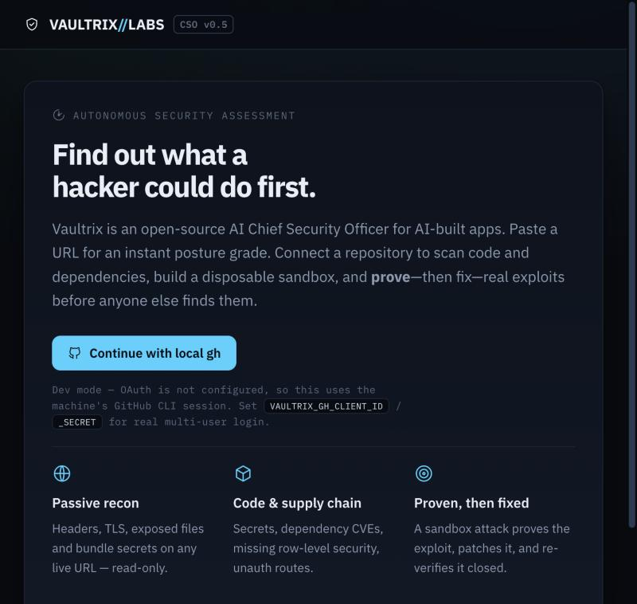
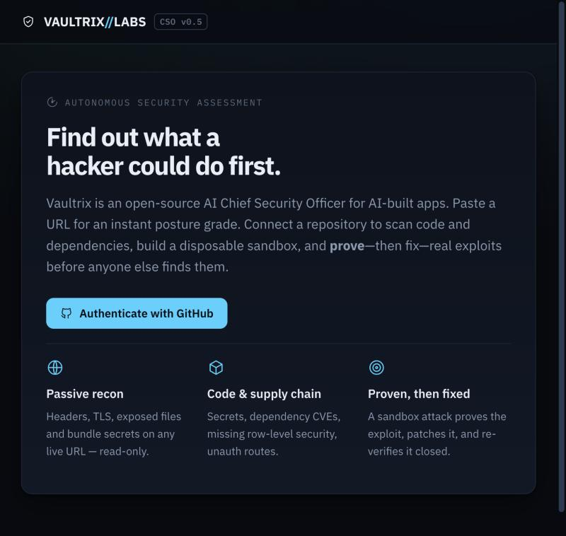
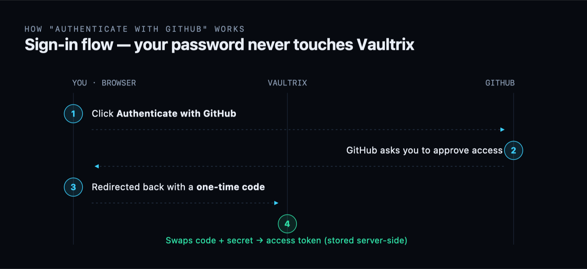
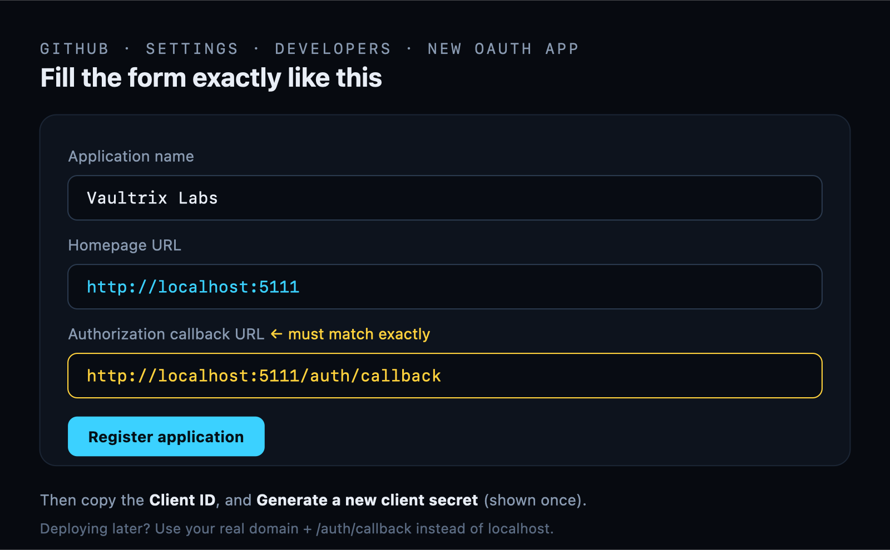
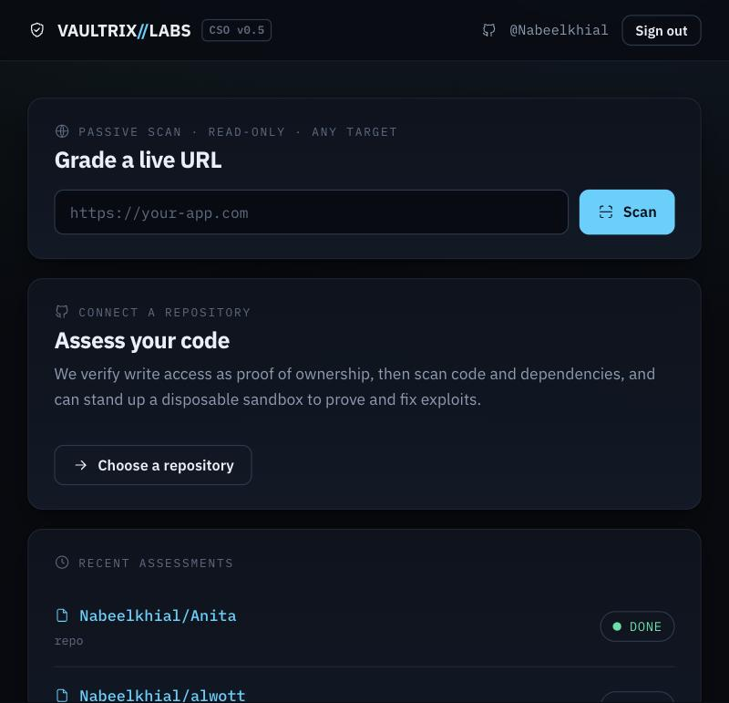
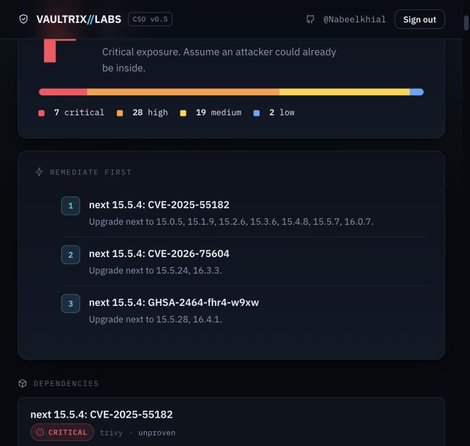

# Enabling real GitHub login

> A step-by-step, visual guide to turning on multi-user **"Login with GitHub"**
> for the Vaultrix web front door. Takes about two minutes. The only part you must
> do yourself is registering the OAuth App — it lives in your GitHub account.

---

## What this changes

Right now the app runs in **dev mode**: a single "Continue with local gh" button
that reuses this machine's GitHub CLI session — only *you*, on *this* machine, can
sign in. Registering an OAuth App turns on a real **Authenticate with GitHub**
button that any user can use.

| Before — dev mode (local `gh`) | After — real OAuth (multi-user) |
|---|---|
|  |  |

The change is automatic: the moment the two GitHub credentials are present, the dev
button disappears and the real sign-in takes over. No code edit needed.

---

## How it works

When a user clicks **Authenticate with GitHub**, Vaultrix never sees their GitHub
password. GitHub handles the login and hands Vaultrix a short-lived code, which the
server exchanges — using your app's secret — for an access token it keeps
**server-side**. The browser cookie only ever holds a random session id.



**Why this is safe for a security product**

- Your users' GitHub passwords never pass through Vaultrix.
- The access token is stored server-side (SQLite), not in the cookie.
- The requested scope is `repo read:user` — `repo` is required only to list and
  clone the private repositories a user explicitly asks Vaultrix to scan.

---

## Step 1 — Register the OAuth App

Go to **GitHub → Settings → Developer settings → OAuth Apps → New OAuth App**
(<https://github.com/settings/developers>) and fill it in **exactly** like this:



| Field | Value (for local testing) |
|---|---|
| Application name | `Vaultrix Labs` (anything) |
| Homepage URL | `http://localhost:5111` |
| **Authorization callback URL** | `http://localhost:5111/auth/callback` — **must match exactly** |

Then click **Register application**, copy the **Client ID**, and click **Generate a
new client secret** (GitHub shows the secret only once — copy it now).

---

## Step 2 — Add your credentials

Create a file at **`interfaces/web/.env`** (same folder as `app.py`). It is
gitignored and never committed:

```dotenv
VAULTRIX_GH_CLIENT_ID=<your Client ID>
VAULTRIX_GH_CLIENT_SECRET=<your Client Secret>
VAULTRIX_SECRET_KEY=<a random 32-byte hex string>
```

Generate the session-signing key with:

```bash
python3 -c "import secrets; print(secrets.token_hex(32))"
```

---

## Step 3 — Restart and confirm

```bash
pkill -f interfaces.web.app; sleep 1
PORT=5111 .venv-web/bin/python -m interfaces.web.app
```

> The port **must stay `5111`** so it matches the callback URL you registered.

Open **http://localhost:5111** — you should now see **Authenticate with GitHub**.
Click it → approve on GitHub → you land on your dashboard as yourself, with your
repositories ready to scan:

| Your dashboard | A finished assessment |
|---|---|
|  |  |

Quick check that `.env` loaded (run while the server is up):

```bash
curl -s localhost:5111/ | grep -q 'Authenticate with GitHub' && echo "OAuth is live"
```

If it still shows the dev button, `.env` is in the wrong place (it must be
`interfaces/web/.env`) or a variable name has a typo.

---

## Deploying later

The `localhost:5111` values are for local testing. For a real deployment, either
add your production URL's `/auth/callback` to the same OAuth App, or register a
separate production app, and set the same three environment variables in that
environment. See [README.md](README.md) for the Docker image and per-feature host
requirements (repo scans need Docker; the sandbox attack/fix need Docker + the
Supabase CLI).
